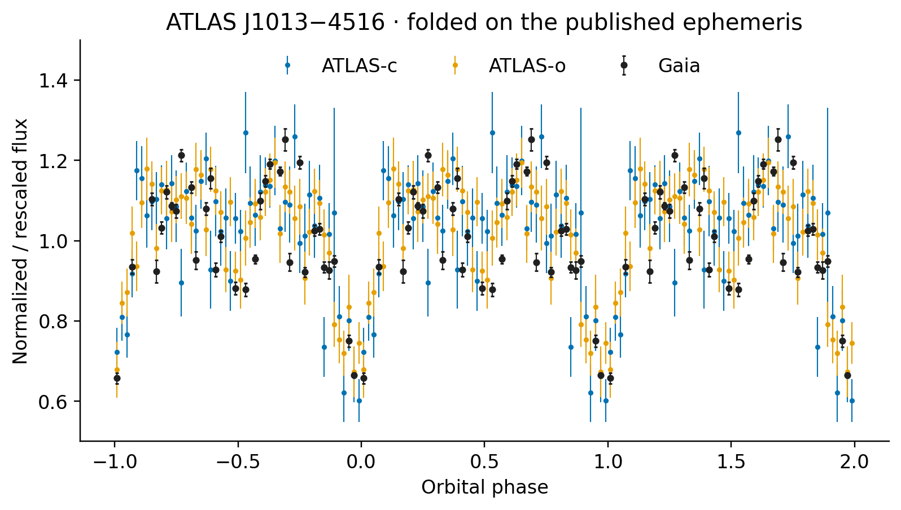

# Gaia epoch photometry of ATLAS J1013−4516

Light curves, timing data, and a Jupyter notebook for the 8.56-minute eclipsing binary ATLAS J1013−4516. Prepared for the MIT Gaia DR4 Warm Up Workshop, November 5–6, 2026.

**[Open the executed notebook](j1013_gaia_figures.ipynb)** to view the light curves, measure seasonal Gaia timings, and construct observed-minus-calculated (O–C) diagrams. Input data are included in `data/`.



## Analysis

The notebook contains 54 processed Gaia measurements, ATLAS photometry, a high-speed g-band light-curve template, and 15 timing epochs. It:

- Applies the original ATLAS cleaning and phase-folding recipe and exports the 50-bin Gaia/ATLAS comparison.
- Fits a quadratic ephemeris to the supplied timing table.
- Remeasures Gaia timings in three seasons containing 20, 19, and 15 measurements, with free seasonal shifts relative to an ephemeris fitted to the 12 non-Gaia epochs.
- Examines profile likelihoods, exposure averaging, and waveform sensitivity, then constructs an O–C using the remeasured Gaia epochs.

## Run

Tested with Python 3.12:

```bash
python -m venv .venv
source .venv/bin/activate
python -m pip install -r requirements.txt
jupyter lab j1013_gaia_figures.ipynb
```

To execute all cells from the command line:

```bash
python scripts/run_notebook.py
```

Run All regenerates PDF/PNG figures in `figures/` and CSV/JSON products in `tables/`. Original input filenames and SHA256 checksums are recorded in `data/source_manifest.json`.

## Citation and attribution

For the binary and published result, cite:

> Chickles, E. T., Chakraborty, J., Burdge, K. B., et al. 2026, “An Eclipsing 8.56 Minutes Orbital Period Mass-transferring Binary,” The Astrophysical Journal, 1000, 237. DOI: [10.3847/1538-4357/ae4871](https://doi.org/10.3847/1538-4357/ae4871).

This work uses data from ESA's [Gaia mission](https://www.cosmos.esa.int/gaia), processed by the [Gaia Data Processing and Analysis Consortium (DPAC)](https://www.cosmos.esa.int/web/gaia/dpac/consortium). DPAC funding is provided by national institutions, especially those participating in the Gaia Multilateral Agreement. ATLAS survey photometry and author-provided high-speed and timing products support the analysis.

Code: [MIT License](LICENSE). Author-created data products, prose, and figures: [CC BY 4.0](LICENSE-DATA). Upstream Gaia/ATLAS data retain their applicable terms and attribution requirements. Repository citation metadata are in `CITATION.cff`.
